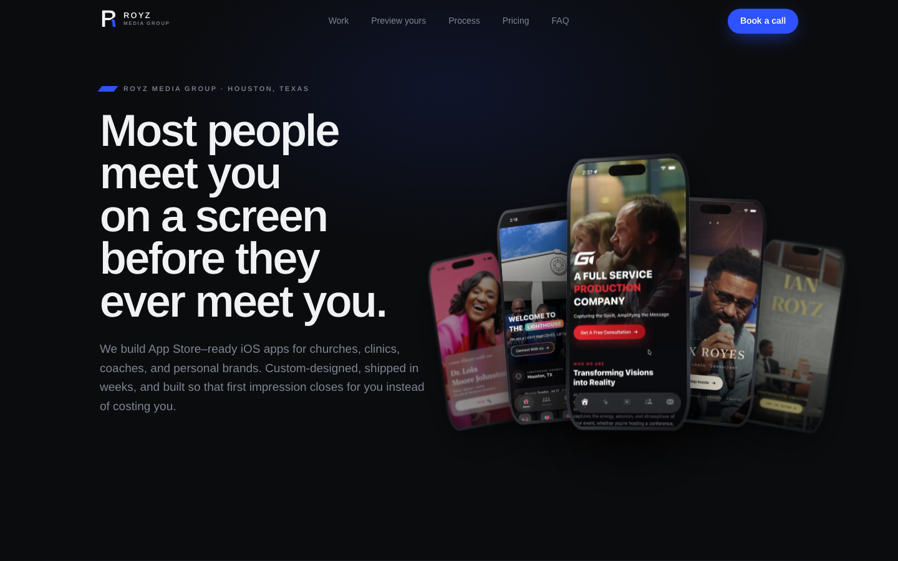
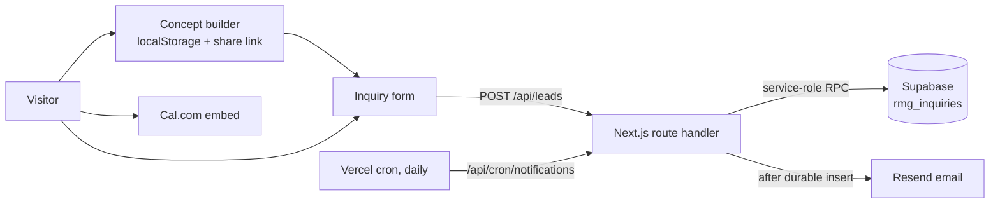

# Royz Media Group

The marketing site for Royz Media Group, a small studio that designs and ships custom iOS apps for churches, clinics, coaches and personal brands. Live at [royzmediagroup.com](https://royzmediagroup.com).



## What it does

The site has to sell a custom app to someone who has never bought software. So it shows real recorded builds, lets the visitor sketch their own app concept in the browser, publishes flat pricing, and books a call or takes an inquiry without any account.

## Features

- **Showroom hero** with a fanned deck of phone mockups that lean toward the pointer (CSS 3D, reduced-motion aware).
- **Work section and case pages** (`/work/[slug]`) for five recorded client builds, each with its named design system, palette and feature list.
- **"Preview yours" concept builder**: pick an industry, name, accent color, layout and features, upload a logo, and see a live phone preview. Concepts save locally, can be shared as a link, and carry into the inquiry form and the booking notes.
- **Audience pages** (`/solutions/[slug]`) for churches, coaches, creators, businesses and clinics.
- **Pricing, process and FAQ** sections driven from one config file, plus `/pricing.md` and `/llms.txt` routes so AI assistants can read the offer.
- **Inquiry API** (`/api/leads`) with validation, idempotent request IDs, database-backed rate limits, a durable receipt before showing success, and separate tracking of email delivery.
- **Daily retry cron** (`/api/cron/notifications`) that re-sends owner notifications that failed, authenticated with `CRON_SECRET`.
- **Cal.com booking** loaded on demand, with a direct-link fallback if the embed fails.
- **Privacy-respecting analytics** (`/api/events`): aggregate event counts only, no personal data in payloads, honors Do Not Track and Global Privacy Control.
- Honest degraded states: if the backend isn't configured, the form says so and offers email and booking instead of faking a receipt.
- Schema.org `ProfessionalService` and `FAQPage` JSON-LD, generated Open Graph image, sitemap, robots, custom 404, security headers.

## How it works



Leads are written to Supabase through service-role-only RPCs (RLS on, no anon privileges) before the visitor sees a receipt. Email is sent afterwards and its status is stored per inquiry, so a failed send is retried by the cron job instead of being lost. Details and SQL are in [`supabase/LEAD-DELIVERY.md`](supabase/LEAD-DELIVERY.md) and [`supabase/rmg-inquiries.sql`](supabase/rmg-inquiries.sql).

## Tech stack

Next.js 16 (App Router), React 19, TypeScript, Tailwind CSS 4, Supabase (Postgres), Resend, Cal.com embed, Vercel (hosting + cron). Tests use Node's built-in test runner.

## Getting started

```sh
npm install
cp .env.example .env.local   # optional; the site runs without it
npm run dev
```

Other scripts: `npm run typecheck`, `npm test`, `npm run build`, `npm start`.

Environment variables (all server-only, see `.env.example`):

| Variable | Purpose |
|---|---|
| `RMG_SUPABASE_URL`, `RMG_SUPABASE_SERVICE_ROLE_KEY` | Database for inquiries |
| `RMG_RATE_LIMIT_SECRET` | Salt for hashed IP rate limiting |
| `RMG_RESEND_API_KEY`, `RMG_EMAIL_FROM`, `RMG_INQUIRY_EMAIL` | Notification email |
| `CRON_SECRET` | Authenticates the retry job |

The app recordings (`public/apps/*.mp4`) are not in this repository because of their size; the posters and responsive WebP variants are.

## Project structure

```
src/
  app/            routes: home, /work, /solutions, /privacy, API routes, OG image, sitemap
  components/     Hero, HeroStage, Work, Previewer, Pricing, LeadForm, Booking, FAQ...
  config/         site.ts (brand, pricing, FAQ), portfolio.ts, solutions.ts
  lib/            preview concept state, analytics, server-side lead + notification logic
supabase/         migration and lead-delivery runbook
scripts/          headless-browser checks for layout, design and video autoplay
tests/            lead delivery tests (mocked database and email)
docs/             design and upgrade notes
```

## Status

Live at [royzmediagroup.com](https://royzmediagroup.com). Booking is live through Cal.com. The inquiry backend is built and tested against mocks; it activates once Supabase and Resend variables are set in Vercel.

Built by [Ian Royes](https://github.com/ianroyes-sys)
